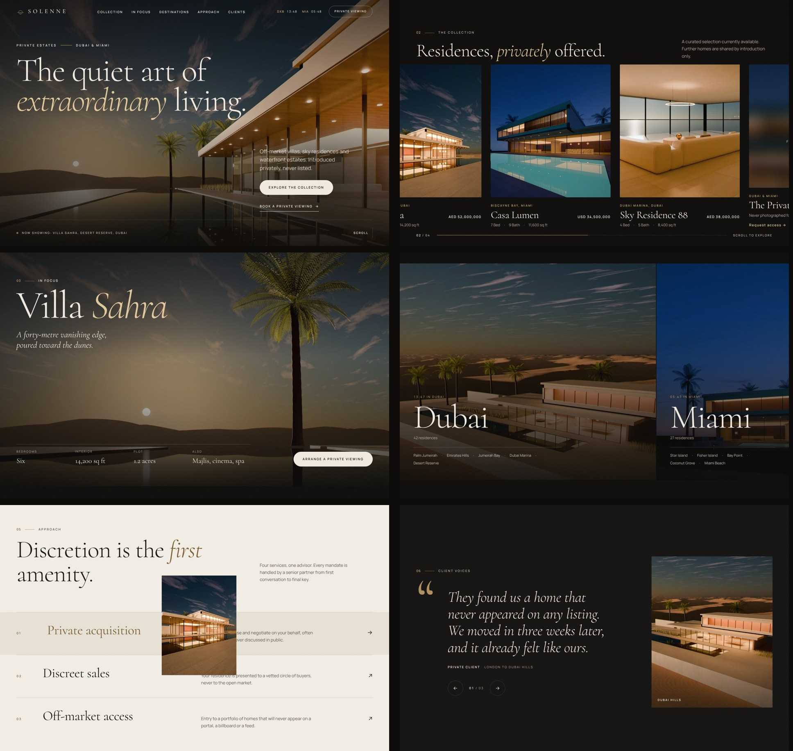

# Solenne Private Estates — cinematic real estate demo

A concept website for a fictional luxury real estate house selling off-market villas, sky residences and waterfront estates in Dubai and Miami. It is built to show prospects what a premium, film-like property website feels like.

Static HTML, CSS and JavaScript. No build step, no framework, no tracking.



## What's inside

- **Opening curtain**: a gold sun-over-horizon mark draws itself, the wordmark rises, a counter runs to 100, then the curtain lifts into the hero. Shown once per browser session.
- **Hero film**: a slow, looping camera glide along Villa Sahra's infinity pool at sunset, crossfading in over the poster image. Pause control included; skipped on phones, data saver and reduced motion.
- **Scroll choreography** (GSAP ScrollTrigger + Lenis smooth scroll): headline lines rise out of masks, the manifesto lights up word by word as you read, counters run, the hero letterboxes as you leave it.
- **The collection**: a pinned horizontal gallery on desktop (scroll down, cards travel sideways), native swipe with arrows on touch screens. Card links prefill the enquiry form.
- **In focus**: the Villa Sahra frame opens from a small window to full bleed.
- **Destinations**: two city panels with live local clocks for Dubai and Miami, hover to expand.
- **Approach**: service rows with an image that follows the cursor.
- **Client voices**: an accessible carousel with matching residence imagery.
- **Private viewing form**: friendly validation and a success state.
- Custom cursor with contextual labels ("View", "Enquire"), magnetic buttons, film grain.

## Run it locally

From the repository root:

```bash
npx serve demos/luxury-real-estate
# or
cd demos/luxury-real-estate && python3 -m http.server 8000
```

Open the printed URL. Opening `index.html` straight from disk also works.

## Deploy

Any static host works: Netlify (drag and drop the folder), Vercel, Cloudflare Pages or GitHub Pages. After deploying, change the `og:image` meta tag in `index.html` to an absolute URL (for example `https://your-domain.com/assets/img/og-image.jpg`) so link previews show the image.

## Make it a client's site

| What | Where |
| --- | --- |
| Brand name, title, description, structured data | `<head>` of `index.html` |
| Logo mark (sun over horizon) | the two `<svg>` marks in `index.html` and `assets/img/favicon.svg` |
| Colours and type scale | CSS custom properties at the top of `assets/css/styles.css` |
| Listings, prices, specs | the `.estate` cards in the collection section |
| Office clocks | `data-clock` attributes (any IANA time zone, for example `Europe/London`) |
| Photos | `assets/img/` (each image ships as AVIF and WebP in several widths; keep the file names or update the `srcset`s) |
| Hero film | `assets/video/hero-sahra.mp4` (H.264) and `.webm` (VP9); `data-src` attributes on the `<video>` |
| Enquiry form | `setupForms()` in `assets/js/main.js` currently simulates a send. Point it at Formspree, Netlify Forms or the client's CRM endpoint. |

All names, figures and testimonials are illustrative and should be replaced with the client's real content.

## Performance and accessibility

- First view is roughly 250 KB gzipped on desktop (HTML, CSS, JS, fonts and the AVIF hero). Every image is responsive (AVIF with WebP fallback, `srcset` and `sizes`), below-the-fold images are lazy, and the film loads only after the page has finished loading.
- Respects `prefers-reduced-motion`: no curtain, no smooth scrolling, no pinning, no film, no autoplay. Content is fully visible without JavaScript.
- Skip link, visible focus states, keyboard-reachable collection cards (focus scrolls the pinned gallery), Escape closes the menu, the carousel stops auto-advancing as soon as it is touched or focused, form errors are announced and linked to their fields.
- No axe-core violations on desktop or mobile.

## Credits and licences

- Every image and the hero film are original 3D renders made in Blender for this demo. No stock photography.
- [GSAP 3.15](https://gsap.com) with ScrollTrigger and SplitText, under the GSAP [standard no-charge licence](https://gsap.com/standard-license).
- [Lenis 1.3](https://github.com/darkroomengineering/lenis), MIT licence.
- [Cormorant](https://github.com/CatharsisFonts/Cormorant) and [Manrope](https://github.com/sharanda/manrope) variable fonts via Fontsource, SIL Open Font Licence 1.1.

## Files

```
demos/luxury-real-estate/
├── index.html
├── assets/
│   ├── css/styles.css
│   ├── js/main.js
│   ├── vendor/        gsap, ScrollTrigger, SplitText, lenis (minified)
│   ├── fonts/         Cormorant (roman + italic), Manrope
│   ├── img/           renders as AVIF + WebP, og-image.jpg, favicon.svg
│   └── video/         hero film loop
└── README.md
```
