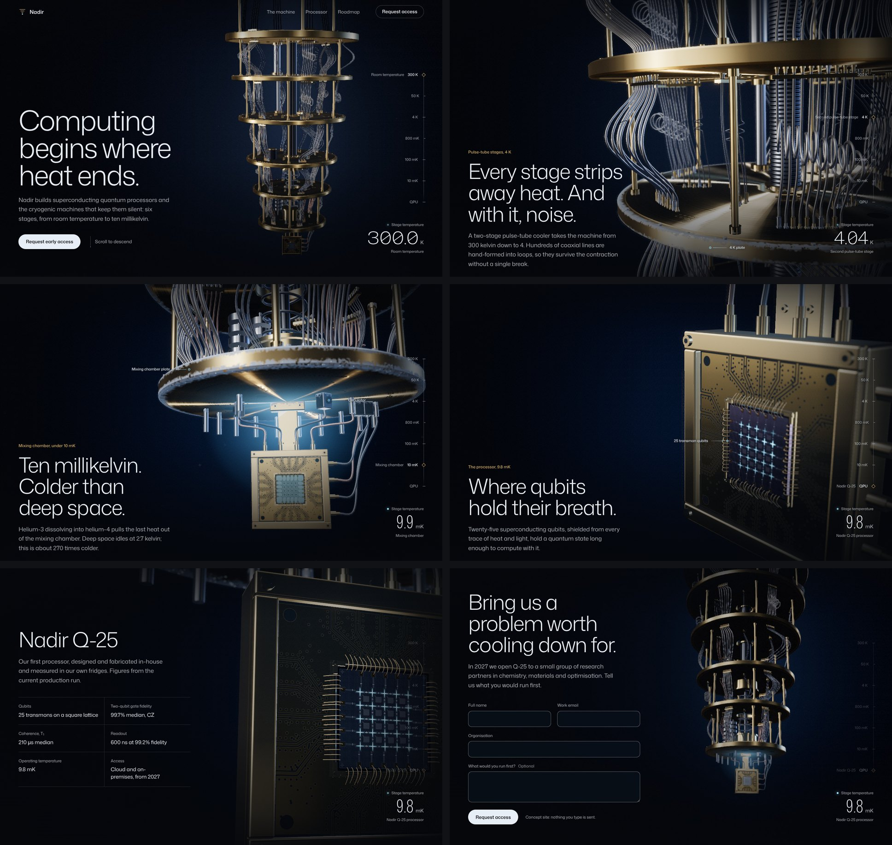

# Nadir — real-time 3D quantum computing demo

A concept website for a fictional quantum computing company. As you scroll, a camera descends through a dilution refrigerator rendered live in the browser, from room temperature down to the processor at ten millikelvin. It is built to show prospects what a cinematic, interactive 3D website feels like.

Static HTML, CSS and JavaScript. The 3D is three.js; the built files are committed, so there is nothing to install to run or host it.



## What's inside

- **A machine rendered live**: the refrigerator is built entirely in code: gold-plated stages, hand-formed coaxial lines, attenuators, circulators, the mixing chamber and a 25-qubit chip with wirebonds. No video, no stock imagery, no downloaded 3D models.
- **One continuous camera move**: scrolling drives a single camera path through eight chapters, and the light, depth of field and colour grade cool down with it.
- **Something happens in every chapter**: frost blooms across the plates at 4 K, a signal pulse travels down a line and dims at each attenuator, a cold glow gathers under the mixing chamber, the qubits wake up one by one and run a two-qubit gate.
- **A live instrument panel**: a gauge and readout track the temperature from 300 K to 9.8 mK. The numerals condense as it gets colder (Mona Sans' width axis). Click a tick to travel there.
- **Callouts that follow the machine**: labels pinned to real parts of the model (plates, attenuators, circulators, the chip) on desktop.
- **Scroll choreography** (GSAP ScrollTrigger + SplitText + Lenis): headlines rise out of masks, specs count up, the roadmap line draws itself.
- **Request access form**: friendly validation, announced errors and a success state.

## Run it locally

From the repository root:

```bash
npx serve demos/quantum-computing
# or
cd demos/quantum-computing && python3 -m http.server 8000
```

Open the printed URL. It needs to be served over http(s): opening `index.html` straight from disk blocks the 3D module, and the page falls back to its still images.

## Edit and rebuild

The sources are in `src/` and are bundled into `assets/js/` with esbuild:

```bash
cd demos/quantum-computing
npm install
npm run build      # or: npm run watch
```

`src/main.js` is the page (scroll, chapters, instrument panel, form). `src/scene/` is the 3D scene (geometry, materials, camera path, post-processing), loaded as a separate chunk after the page has finished loading. `src/stage/` maps the scroll position to chapters and picks the quality tier. `scene-test.html` shows the scene on its own (`?k=0`…`7` jumps to a chapter, `?tier=high|mid|low`); it needs `npm install` and a local server.

After changing the scene, re-render the still images so the first paint and the fallback match it:

```bash
npm run stills                                  # PNG renders into test/stills/ (slow without a GPU)
python3 tools/encode-stills.py test/stills      # AVIF + WebP posters into assets/img/ (needs Pillow)
npx serve -l 8000 .                             # then, in a second terminal:
node tools/og.mjs                               # link preview card into assets/img/og-image.jpg
```

## Deploy

Any static host works: Netlify (drag and drop the folder), Vercel, Cloudflare Pages or GitHub Pages. With GitHub Pages serving this repository the demo lives at https://uddeshya776-stack.github.io/agency-site/demos/quantum-computing/

Link previews need absolute URLs, so `og:url` and `og:image` in `index.html` point at that address. When you deploy somewhere else, change both to the new address.

## Make it a client's site

| What | Where |
| --- | --- |
| Brand name, title, description and link preview | `<head>` of `index.html` |
| Logo mark | the brand `<svg>` in `index.html` and `assets/img/favicon.svg` |
| Colours and type scale | CSS custom properties at the top of `assets/css/styles.css` |
| Chapter text | the `<section data-chapter>` blocks in `index.html` |
| Temperatures, stage names and gauge | `src/hud.js` and the `.gauge` list in `index.html` |
| The machine, the camera path and the grade per chapter | `src/scene/` |
| Still images (shown first, and instead of 3D with reduced motion or without WebGL) | `assets/img/poster-*`, rendered from the live scene by `tools/stills.mjs` |
| Request form | the `form` block in `src/main.js` currently simulates a send. Replace the timeout with a `fetch()` to Formspree, Netlify Forms or the client's CRM endpoint, then rebuild. |

All names and figures are illustrative and should be replaced with the client's real content.

## Performance and accessibility

- The page is readable and interactive before any 3D loads: the first paint is a still of the opening shot, and three.js is fetched only after the page has finished loading, then crossfades in.
- Quality adapts to the device: a tier is picked from the GPU and the screen (phones and tablets start at mid, with FXAA instead of MSAA), and a frame-time governor lowers the resolution, then the post effects, if frames run long. It restores them once frames recover, and it recognises a 30 Hz cap (iOS Low Power Mode, battery savers) instead of mistaking it for a slow GPU. The scene is built in small slices so it never blocks input.
- Frames are paced: at most 60 per second on 120 Hz screens, and 30 on touch screens while the camera rests, so phones stay cool. The stage is sized to the large viewport, so the phone's address bar never resizes the 3D mid-scroll.
- If the browser drops the graphics context (common on phones under memory pressure), the stills stand in and the 3D comes back when the context is restored.
- Respects `prefers-reduced-motion`: no smooth scrolling, no camera motion, still images instead of the live scene, every element shown in its final state. Without WebGL 2, or with `?static` in the URL, the same still images are used. Content is fully readable without JavaScript.
- Skip link, visible focus states, keyboard-reachable navigation and menu (Escape closes it), form errors announced and linked to their fields. The instrument panel is decorative and hidden from screen readers; the same information is in the text.

## Credits and licences

- The 3D scene and every image are original, generated in code for this demo. No stock imagery.
- [three.js](https://threejs.org) r186, MIT licence.
- [GSAP 3.15](https://gsap.com) with ScrollTrigger and SplitText, under the GSAP [standard no-charge licence](https://gsap.com/standard-license).
- [Lenis 1.3](https://github.com/darkroomengineering/lenis), MIT licence.
- [Mona Sans](https://github.com/github/mona-sans) variable font by GitHub, SIL Open Font Licence 1.1 (`assets/fonts/OFL-mona-sans.txt`).

## Files

```
demos/quantum-computing/
├── index.html
├── assets/
│   ├── css/styles.css
│   ├── js/            built bundle: main.js + chunks/ (the 3D scene)
│   ├── fonts/         Mona Sans (text) and a subset for the readout
│   └── img/           stills as AVIF + WebP, og-image.jpg, favicon.svg
├── src/               sources for assets/js
├── tools/             build and still renderer
├── package.json
└── README.md
```
