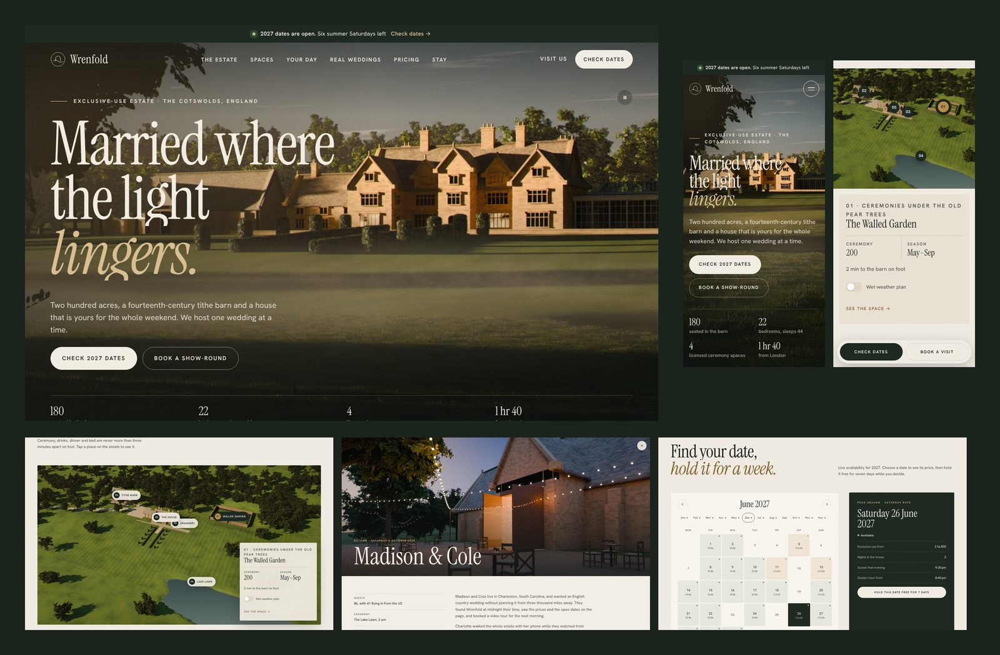

# Wrenfold — wedding venue concept site

A concept website for a fictional exclusive-use wedding estate in the Cotswolds, England. It shows wedding-venue owners (US and UK) what a premium, conversion-focused venue website can feel like: cinematic, fast on phones, and honest about prices and dates.

Static HTML, CSS and JavaScript. No framework, no tracking. Every image is an original 3D render (Blender), not stock.



## What's inside

- **Invitation opening**: the monogram draws itself, the name rises and the page opens like a folded card. Once per visit, under 2.5 seconds, skipped for reduced motion.
- **Hero**: golden-hour manor across a misty lawn, slow drifting mist, two clear actions (check dates, book a show-round) and the four facts couples ask first.
- **"2027 dates are open" bar**: the number of summer Saturdays left is counted live from the calendar data.
- **Estate map**: numbered pins on an aerial render. Each opens capacity, walking time and, for outdoor spaces, a wet-weather switch.
- **Spaces**: on desktop the photo stays pinned and changes with a soft wipe as you read about each space; on phones each space is a card. Capacity table underneath.
- **Your day**: a pinned horizontal timeline from 1.30 pm vows to Sunday brunch. The background turns from afternoon to dusk to night, and a small sun travels its arc with the clock.
- **Real weddings**: three stories (summer garden, a US destination wedding, a winter Hindu and civil wedding) open in a full-screen story with facts, what it cost, the day's timeline, a gallery and supplier credits.
- **Pricing**: season tabs, £/$ switch, what's always included, and an estimator (month, day, guests, menu) that hands its result to the enquiry form. "Get the full price guide" is an email-gated dialog instead of a PDF link.
- **2027 availability**: a full calendar with month jumps and keyboard support. Each date shows its price; choosing one shows the rate, nights included, sunset time and golden hour for that exact date, then "Hold this date free for 7 days". Booked dates suggest the nearest open ones.
- **Visit & enquire**: three fields to check a date, or pick a real upcoming show-round slot or the open day. Friendly validation and a personal success message. Shows whether the coordinator is online right now (UK time).
- Sticky "Check dates / Book a visit" dock on phones, film grain, reduced-motion and no-JavaScript paths.

## Run it locally

```bash
cd demos/wedding-venue && python3 -m http.server 8000
```

## Make it a client's site

| What | Where |
| --- | --- |
| Name, address, contact, meta tags | `tools/index.src.html` (then `python3 tools/build.py html`) |
| Prices per season and day, USD rate | `PRICES` and `USD` at the top of `assets/js/main.js` |
| Availability | `statusOf()` in `assets/js/main.js` makes demo data; point it at the client's calendar (HoneyBook, Tripleseat or a Google Sheet as JSON) |
| Estate map pins | `PLACES` in `main.js`, positions in `tools/aerial-hotspots.json` |
| Real wedding stories | `STORIES` in `main.js` |
| Venue location (for sunset times) | `VENUE` in `main.js` |
| Photos | drop new PNG/JPGs named like the keys in `IMAGES` (`tools/build.py`) into a folder and run `python3 tools/build.py images <folder>` then `python3 tools/build.py html` |
| Forms | `initEnquiry()` and `initGuide()` simulate a send; point them at Formspree, Netlify Forms or the venue's CRM |
| Colours and type | custom properties at the top of `assets/css/styles.css` |

All names, people, prices, dates and testimonials are illustrative.

## Build

`tools/build.py` encodes every image to AVIF + WebP in several widths and expands the `<!--pic:...-->` macros in `tools/index.src.html` into `index.html` with full `srcset`s and sizes. Needs Python 3 with Pillow 11+.

Render scripts for the images live outside the repo (project files: `demos/wedding-venue/render-source/`).
